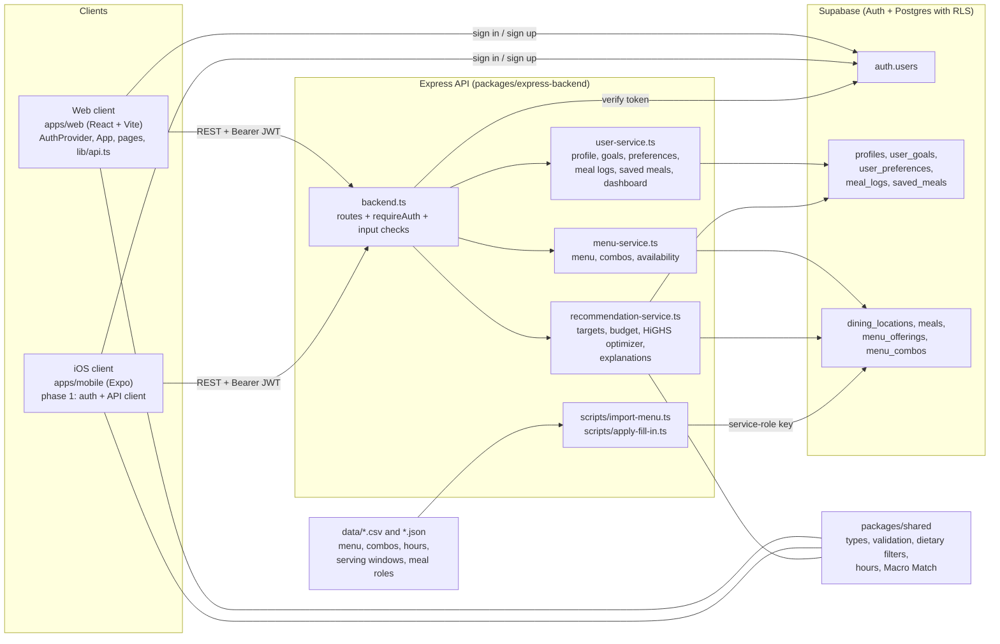

# **<u>STUDENT PROJECT TEMPLATE (SRS)</u>** 

_<u>(INSTRUCTION FOR STUDENTS: THIS DOCUMENT SERVES AS THE FORMAL</u> 'CONTRACT' FOR YOUR TEAM PROJECT. IT MUST BE MAINTAINED IN YOUR GITHUB_ 

_<u>REPOSITORY.)</u>_ 

# **<u>CAMPUS PROVISION TRACKER</u>** 

# **SOFTWARE REQUIREMENTS SPECIFICATION** 

**INSTRUCTOR:** LARA NICHOLS-BROWN 

**TERM:** FALL 2026 

**SECTION:** 11 

# **THE ENGINEERING TEAM:** 

1. **STUDENT A:** ALAN MATHEW — SCRUM MASTER

2. **STUDENT B:** AARAV BABEL — PROJECT MANAGER

3. **STUDENT C:** MAX PLANKAR — LEAD ENGINEER 

# **PROJECT ASSETS:** 

- **GITHUB:** https://github.com/AlanGMathew2006/CSC-3100-AMA 

- **DEPLOYMENT:** [LINK TO LIVE SITE] 

# **DOCUMENT HISTORY:** 

|LAST DATE CHANGED: WHO: WHAT WAS CHANGED:|
|---|
|**2026-09-23** **Alan Mathew, Aarav Babel, Max Plankar** Replaced placeholder workout stories with coordinated Campus Provision Tracker user stories. Added first-author attribution, acceptance criteria, assumptions, and stakeholder questions.|
|**2026-09-25** **Max Plankar** Added two more user stories regarding recommendation nutrition and cost details and dining-location filtering. Updated the related acceptance criteria, functional requirements, and traceability entries.|
|**2026-09-25** **Aarav Babel** Added US-06 and US-07 covering daily dining-dollar budgeting and meal-to-target nutrition comparison. Updated the related acceptance criteria, functional requirements, and traceability entries.|
|**2026-09-25** **Alan Mathew** Added US-08 and US-09 covering allergen and ingredient exclusions and saving favorite meals. Updated the related acceptance criteria, functional requirements, and traceability entries.|
|**2026-11-17** **Aarav Babel** Filled in the traceability matrix, REST endpoints, non-functional requirements, data requirements, UML diagram and section 8 (AI usage) from the current code.|
|**2026-11-17** **Aarav Babel** Updated the US-08 traceability row for the new allergen and avoided-food settings in onboarding and the Profile page, and changed the table of contents entry to PostgreSQL.|

# **CAMPUS PROVISION TRACKER SOFTWARE REQUIREMENTS SPECIFICATION (SRS)** 

**COURSE: CSC 3100 DATE: 2026-09-23**

|**TABL**|**E OF**|**CONTENTS**|
|---|---|---|
|**1. **|**INTR**|**ODUCTION ...................................................................................... [PAGE #]**|
||**`O`**|**1.1 PROJECT PURPOSE**|
||**`O`**|**1.2 INTENDED AUDIENCE**|
||**`O`**|**1.3 PROJECT SCOPE**|
|**2. **|**USER**|**STORIES ....................................................................................... [PAGE #]**|
||**`O`**|**2.1 USER FEATURES (THE"SHALL" STATEMENTS)**|
||**`O`**|**2.2 ADMIN FEATURES**|
|**3. **|**FUNC**|**TIONAL REQUIREMENTS....................................................... [PAGE #]**|
|**4. **|**NON-**|**FUNCTIONAL REQUIREMENTS ............................................ [PAGE #]**|
||**`O`**|**4.1 DATA INTEGRITY & SECURITY**|
||**`O`**|**4.2 PERFORMANCE & USABILITY**|
|**5. **|**SYST**|**EM ARCHITECTURE ................................................................ [PAGE #]**|
||**`O`**|**5.1 REST API ENDPOINTS**|
||**`O`**|**5.2 DATABASE SCHEMA (POSTGRESQL)**|
|**6. **|**USER**|**INTERFACE (UI) ...................................................................... [PAGE #]**|
||**`O`**|**6.1 WIREFRAMES / MOCKUPS**|
|**7. **|**DATA**|**REQUIREMENTS ..................................................................... [PAGE #]**|
||**`O`**|**7.1 LIST OF PERSISTENT DATA**|
|**8. **|**TRAC**|**EABILITY MATRIX ................................................................. [PAGE #]**|
|**9. **|**APPE**|**NDICES ....................................................................................... [PAGE #]**|

# **1.** **<u>INTRODUCTION</u>** 

- **<u>PROBLEM STATEMENT:</u>** <u>IT IS VERY DIFFICULT FOR MANY STUDENTS TO OPTIMIZE THEIR DINING DOLLARS IN A WAY THAT ALLOWS THEM TO REACH THEIR DAILY MACRONUTRIENT GOALS</u> 

- **<u>TARGET AUDIENCE:</u>** <u>FIRST AND SECOND YEAR CAL POLY STUDENTS WHO RELY ON A DINING PLAN FOR THEIR MEALS</u> 

- **<u>SCOPE:</u>** <u>WITHIN THE SCHOOL, CAL POLY</u> 

# **2.** **<u>USER STORIES</u>** 

# _<u>USER STORIES FOLLOW THE FORMAT:</u>_ **_"AS A [TYPE OF USER], I WANT TO [ACTION]_** 

# **_<u>SO THAT [VALUE/BENEFIT]."</u>_** 

These stories describe the connected student experience: a student can review their available dining dollars, provide nutritional preferences, and use those inputs to receive food recommendations.

|ID|USER STORY|FIRST AUTHOR|PRIORITY|
|---|---|---|---|
|US-01|As a Cal Poly student with a dining plan, I want to view my current dining dollar balance so that I know how much I can spend on food.|Alan Mathew|1|
|US-02|As a student with specific nutritional needs, I want to edit nutritional filters so that recommendations reflect my preferences.|Aarav Babel|2|
|US-03|As a student who wants to make informed meal choices, I want to receive food recommendations based on my nutritional filters and dining dollar balance so that I can improve my nutrition while using my dining dollars effectively.|Max Plankar|3|
|US-04|As a student comparing dining options, I want to view the nutrition and dining dollar cost of each recommended item so that I can choose a meal that fits my needs and budget.|Max Plankar|4|
|US-05|As a student choosing where to eat, I want to filter recommendations by dining location so that I can find suitable options at a convenient campus location.|Max Plankar|5|
|US-06|As a student managing a limited dining budget, I want to set a target amount of dining dollars to spend per day so that I can pace my spending throughout the quarter.|Aarav Babel|6|
|US-07|As a student trying to meet my nutrition goals, I want to see how closely a recommended meal matches my calorie and macronutrient targets so that I can compare recommendations more effectively.|Aarav Babel|7|
|US-08|As a student with dietary restrictions, I want to exclude foods containing allergens or ingredients I avoid so that recommendations are safe to eat.|Alan Mathew|8|
|US-09|As a student, I want to save favorite meals so that I can quickly find dining options I enjoyed before.|Alan Mathew|9|

## **2.1 ACCEPTANCE CRITERIA**

### **US-01: View current dining dollar balance**

- **Given** a student has access to the Campus Provision Tracker, **when** the student opens their dining balance, **then** the system displays the student's current dining dollar amount.
- **Given** the dining dollar amount is unavailable, **when** the student requests the balance, **then** the system clearly indicates that the balance could not be retrieved instead of displaying an invented amount.

### **US-02: Edit nutritional filters**

- **Given** a student is viewing their nutritional preferences, **when** the student changes a filter, **then** the system saves and displays the updated filter value.
- **Given** a student has saved nutritional filters, **when** recommendations are requested, **then** the system uses those filters as recommendation inputs.

### **US-03: Receive food recommendations**

- **Given** a student has a dining dollar balance and nutritional filters, **when** the student requests recommendations, **then** the system presents food recommendations that use both inputs.
- **Given** the student changes a nutritional filter or dining dollar balance, **when** recommendations are requested again, **then** the system reflects the updated input values.

### **US-04: View recommendation nutrition and cost**

- **Given** a student receives a food recommendation, **when** the student views the recommendation details, **then** the system displays the item's available nutritional information and dining dollar cost.
- **Given** nutrition or cost information is unavailable for a recommended item, **when** the student views its details, **then** the system clearly identifies the unavailable information instead of displaying an invented value.

### **US-05: Filter recommendations by dining location**

- **Given** recommendations are available for multiple dining locations, **when** the student selects a dining location, **then** the system displays recommendations available at that location.
- **Given** the student clears the dining location filter, **when** recommendations are displayed, **then** the system shows recommendations from all available dining locations.

### **US-06: Set a daily dining dollar target**

- **Given** a student is managing their dining budget, **when** the student enters a daily dining dollar target, **then** the system saves and displays that target for use in future recommendations.
- **Given** a student has an active daily dining dollar target, **when** recommendations are generated, **then** the system uses that target to help pace the student's spending throughout the quarter.

### **US-07: Compare meal alignment to nutrition targets**

- **Given** a student has calorie and macronutrient targets, **when** the student views a recommended meal, **then** the system indicates how closely the meal matches those targets.
- **Given** multiple recommended meals are available, **when** the student compares them, **then** the system helps highlight which recommendation is closest to the student's nutrition goals.

### **US-08: Exclude allergens and avoided ingredients**

- **Given** a student has specified allergens or ingredients to avoid, **when** recommendations are generated, **then** the system excludes meals containing those allergens or ingredients.
- **Given** ingredient information is unavailable for a potential recommendation, **when** dietary restrictions are active, **then** the system clearly identifies the missing information instead of presenting the meal as safe to eat.

### **US-09: Save favorite meals**

- **Given** a student is viewing a meal, **when** the student saves it as a favorite, **then** the system adds the meal to the student's saved favorites.
- **Given** a student has saved favorite meals, **when** the student opens their favorites, **then** the system displays those meals so the student can quickly find them again.

## **2.2 ASSUMPTIONS**

- Students using the tool have a Cal Poly dining plan and a current dining dollar balance available to the system.
- Nutritional filters are selected by the student and may be changed as their needs change.
- Recommendations are informational and support meal planning; they do not replace professional nutritional advice.

## **2.3 STAKEHOLDER QUESTIONS**

- What types of nutritional filters should the first version support?
- How should the system calculate the number of meals per day for a student?
- Which dining locations and menu items should be included in recommendations?

# **3.** **<u>FUNCTIONAL REQUIREMENTS</u>**

_THE SYSTEM SHALL..._

|ID|REQUIREMENT|PRIORITY|
|---|---|---|
|FR-01|The system shall display the student's current dining dollar balance.|1|
|FR-02|The system shall allow the student to create and edit nutritional filters.|2|
|FR-03|The system shall generate food recommendations using the student's nutritional filters and dining dollar balance.|3|
|FR-04|The system shall display available nutritional information and dining dollar cost for each recommended item.|4|
|FR-05|The system shall allow the student to filter recommendations by dining location.|5|
|FR-06|The system shall allow the student to set a daily dining dollar target for pacing spending throughout the quarter.|6|
|FR-07|The system shall indicate how closely each recommended meal matches the student's calorie and macronutrient targets.|7|
|FR-08|The system shall allow the student to exclude recommended foods containing specified allergens or avoided ingredients.|8|
|FR-09|The system shall allow the student to save and view favorite meals.|9|

# **<u>4. NON-FUNCTIONAL REQUIREMENTS</u>** 

- **<u>INTEGRITY:</u>** Bad data is rejected before it is stored or shown.

   - **`O`** The API checks request bodies before saving them: numeric fields must be non-negative numbers, onboarding numbers must be whole numbers, list fields must be arrays of short strings, `theme` must be light or dark, and a meal log needs a name (`validate`, `validateIntegers`, `validateStringArrays`, `validatePreferenceSettings` in `packages/express-backend/backend.ts`). Bad input returns HTTP 400 with an error message.

   - **`O`** The database also checks values (for example `check (dining_dollars_balance >= 0)`, non-negative nutrition and prices, theme values) in `packages/express-backend/supabase/schema.sql`.

   - **`O`** The menu import (`npm run import:menu`) validates every row of the data files before writing anything and stops on the first problem: duplicate or missing ids, prices and nutrition that are not non-negative numbers, unknown allergens, tags and meal roles, a missing collection date, hours or serving windows without a source (`packages/express-backend/scripts/menu-import/pipeline.ts`).

   - **`O`** Allergens and dietary tags only count when they are marked verified: `allergens_verified` must be `yes` with an `allergen_source` (an official chain source), and allergens or tags without verification are rejected by the import. Without verified data the recommendations never present a meal as safe for an allergen or dietary filter ("Allergen info unavailable", `mealRestrictionReasons` in `packages/shared/src/dietary.ts`).

   - **`O`** Missing prices, serving times and nutrition values are left blank in the data files and are never guessed; the app shows "unavailable" for them. Items that are free with a meal may not be priced at $0.

   - **`O`** Errors from the API or Supabase are caught and shown to the user as a message with a Retry button on the data screens. Supabase sign-in errors are mapped to safe messages (`authErrorMessage` in `apps/web/src/lib/authErrors.ts`).

- **<u>SECURITY:</u>** Sign-in is handled by Supabase Auth.

   - **`O`** Passwords are hashed and stored by Supabase Auth. Our code never stores or hashes passwords itself (there is no bcrypt in this project). Sign-up requires a password of at least 12 characters (`packages/shared/src/validation.ts`).

   - **`O`** The web app sends the Supabase access token (JWT) as a Bearer token. The backend checks it on every `/api` route (`requireAuth` in `packages/express-backend/backend.ts`, which calls `auth.getUser`) and rejects missing or invalid tokens with HTTP 401. Only `GET /health` is public.

   - **`O`** The backend talks to the database as the signed-in user, so Row Level Security applies. `schema.sql` enables RLS on every table: users can only read and change their own profile, goals, preferences, meal logs and saved meals, and menu data (locations, meals, offerings, combos) is read-only for signed-in users. Only the protected import scripts use the service-role key.

   - **`O`** Credentials come from environment variables (`SUPABASE_URL`, `SUPABASE_PUBLISHABLE_KEY`, `SUPABASE_SERVICE_ROLE_KEY`, `CORS_ORIGIN`, and the `VITE_` variables for the web app). `.env` files are git-ignored. The client only gets the publishable key, never the service-role key.

   - **`O`** The API only accepts browser requests from the origins listed in `CORS_ORIGIN`.

- **<u>USABILITY</u>:**

   - **`O`** Mobile-first layout with a bottom navigation bar, kept readable at narrow phone widths and on desktop (checked by the browser smoke tests in `apps/web/e2e`).

   - **`O`** Values that are not known say "unavailable" instead of 0 or a dash. Calories and grams are shown as whole numbers. A missing price says "Free with a meal", "Combo only" or "Price unavailable" (`apps/web/src/lib/format.ts`, `priceText` in `apps/web/src/lib/mealLog.ts`).

   - **`O`** Every recommendation has a short one-line explanation and a Macro Match score (0-100) with a breakdown per macro.

   - **`O`** Data screens show loading, error (with Retry) and empty states. When there are no recommendations the app explains why (over the daily budget, no open locations, no matching meals) and links to the screen where the student can change it.

   - **`O`** Locations show Open or Closed from the official hours, and an "Open now" filter hides meals that are not served right now. Locations whose hours are not collected say "Hours unavailable".

   - **`O`** Forms validate input and give specific messages (for example "Use at least 12 characters for your password."). Buttons show a loading state while submitting.

   - **`O`** A light and a dark theme, saved in the student's preferences. The "Halal-friendly" option says it only hides meals marked as containing pork and is not halal certification.

   - **`O`** Recommendations are computed on the server by a deterministic optimizer, so the same inputs always give the same result.

# **<u>5. SYSTEM ARCHITECTURE</u>** 

- **<u>REST ENDPOINTS:</u>** METHOD | URL | DESCRIPTION. All routes are in `packages/express-backend/backend.ts`. Every `/api/...` route needs a signed-in user (`Authorization: Bearer <Supabase access token>`, otherwise 401). Only `GET /health` is public. Errors return JSON `{ "error": "..." }`.

   - **`O`** GET | /health | Health check, returns `{ "status": "ok" }`. No sign-in needed.

   - **`O`** GET | /api/profile | The signed-in student's profile (Dining Dollar balance, daily spending target, onboarding status). Needs sign-in.

   - **`O`** PATCH | /api/profile | Updates the balance and/or daily spending target. Needs sign-in.

   - **`O`** GET | /api/goals | The student's calorie, protein, carbohydrate, fat and fiber targets. Needs sign-in.

   - **`O`** PUT | /api/goals | Creates or replaces the nutrition targets. Needs sign-in.

   - **`O`** POST | /api/onboarding/complete | Saves balance, daily target, nutrition targets, priorities, dietary restrictions and preferred locations, and marks onboarding done. Needs sign-in.

   - **`O`** GET | /api/preferences | The student's dietary restrictions, allergens, cuisine and location preferences, excluded foods, priorities, budget alerts and theme. Needs sign-in.

   - **`O`** PUT | /api/preferences | Creates or replaces those preferences. Needs sign-in.

   - **`O`** GET | /api/locations | Lists dining locations with their hours. Needs sign-in.

   - **`O`** GET | /api/menu | The full imported campus menu with each item's latest price per location, plus combos; `?open_now=true` drops closed locations. Needs sign-in.

   - **`O`** GET | /api/menu-offerings | Lists menu offerings, optionally filtered by `location_id` and `service_date`. Needs sign-in.

   - **`O`** GET | /api/meal-targets | Per-meal nutrition targets and the Dining Dollar budget for the next meal; optional `meals_remaining` (1-6). Needs sign-in.

   - **`O`** GET | /api/recommendations | The best meals per dining location for the student's remaining targets and budget; optional `limit` (1-10), `location_id` and `meals_remaining`. Needs sign-in.

   - **`O`** GET | /api/dashboard | Today's and this week's nutrition and spending totals, goals and recent meal logs; optional `day_start` and `week_start`. Needs sign-in.

   - **`O`** GET | /api/meal-logs | Lists the student's logged meals, optional `from` and `to`. Needs sign-in.

   - **`O`** POST | /api/meal-logs | Logs a meal (a price and nutrition snapshot); returns 201. Needs sign-in.

   - **`O`** DELETE | /api/meal-logs/:logId | Deletes one of the student's meal logs; returns 204. Needs sign-in.

   - **`O`** GET | /api/saved-meals | Lists the student's saved (favorite) meals. Needs sign-in.

   - **`O`** PUT | /api/saved-meals/:mealId | Saves a meal as a favorite. Needs sign-in.

   - **`O`** DELETE | /api/saved-meals/:mealId | Removes a meal from the favorites; returns 204. Needs sign-in.

- **<u>UML:</u>** Main pieces of the system. The web client (and the Expo iOS client, phase 1) call the Express API with a Supabase access token; the API reads and writes Supabase Postgres as the signed-in user, so Row Level Security applies. The menu import scripts write the menu tables with the service-role key.

# **5.** **<u>USER INTERFACE (UI)</u>** 

# **A.** **<u>5.1 WIREFRAMES / MOCKUPS</u>** 

See screenshots in the presentation.

# **6.** **<u>DATA REQUIREMENTS</u>** 

All persistent data is stored in Supabase (PostgreSQL, with Supabase Auth for accounts). The schema is in `packages/express-backend/supabase/schema.sql` and `packages/express-backend/supabase/migrations/`. Every table has Row Level Security turned on.

**Per-student tables** (a student can only read and change their own rows):

|TABLE|WHAT IT STORES|
|---|---|
|`profiles`|One row per student (same id as `auth.users`): display name, Dining Dollar balance, daily spending target, whether onboarding is done. A profile is only created when onboarding is submitted.|
|`user_goals`|Calorie, protein, carbohydrate, fat and optional fiber targets.|
|`user_preferences`|Dietary restrictions, allergens, cuisine preferences, preferred location ids, excluded foods, nutrition priorities, budget alerts on/off, theme.|
|`meal_logs`|Meals the student logged, with a snapshot of the name, location, price and nutrition at that time, and when it was eaten.|
|`saved_meals`|Favorite meals (student id + meal id).|

**Menu tables** (read-only for students; written only by the protected import scripts):

|TABLE|WHAT IT STORES|
|---|---|
|`dining_locations`|Campus dining locations, whether they take Dining Dollars, and weekly opening hours (`hours`, Los Angeles time).|
|`meals`|Menu items: restaurant, category, serving, calories, protein, carbs, fat, fiber, allergens, dietary tags, `allergens_verified` and its source, serving windows (for example breakfast until 10:30), meal role (main, side, drink, dessert, sauce), `free_with_meal`, and the nutrition source.|
|`menu_offerings`|The price of a meal at a location for a service date, with its price source.|
|`menu_combos`|Combos such as Panda Express bowls and plates and Chick-fil-A meals: price, number of bases and entrees, serving windows, and fixed contents with side and drink choices.|

**Where the menu data comes from.** The source files are in `data/` and are loaded by `npm run import:menu` (re-running is safe: it upserts). Each row keeps its source and the date it was collected.

|FILE|CONTENT|SOURCE|
|---|---|---|
|`data/menu_items.csv`|192 items (Chick-fil-A, Subway, Taco Bell, Panda Express): nutrition, allergens, tags, serving size, prices.|Nutrition and allergens come from each chain's official site or nutrition guide (chick-fil-a.com, Subway U.S. Nutrition Information PDF, tacobell.com, pandaexpress.com); a few items only have calories from the Cal Poly Dine On Campus menu. Prices come from the Grubhub campus ordering app (Cal Poly) or the Subway online menu for the Cal Poly stores.|
|`data/menu_combos.csv`|Combo names, descriptions, number of bases and entrees, and prices.|Grubhub campus ordering app (Cal Poly) and the Panda Express online menu.|
|`data/combo_contents.json`|What fixed-content combos contain, and which side or drink can be picked.|Built from the rows in `menu_combos.csv` and the menu items; each entry records its source and whether it is verified, and a fixed combo is only recommended once verified.|
|`data/dining_hours.json`|Weekly hours for each dining location.|Cal Poly Dine On Campus "Hours This Week" pages.|
|`data/serving_windows.json`|When specific items are served (for example breakfast).|Chain websites where available (for example chick-fil-a.com); each rule records its source and whether it was verified, and unverified windows are marked unknown.|
|`data/meal_roles.json`|The role of each item (main, side, drink, dessert, sauce).|Rules kept in the repo by the team (by restaurant and category, with overrides per item).|
|`data/manual_fill_in.csv`|Prices, serving windows and combo contents that could not be verified yet; filled in by hand and applied with `npm run apply:fill-in`.|Grubhub campus app or the store; blank until verified.|

Values that could not be checked against a source are left blank rather than guessed (`data/DATA_TODO.md`).

# **7.** **<u>TRACEABILITY MATRIX</u>** 

|ID|REQUIREMENT|LINE OF CODE|
|---|---|---|
|US-01|The system shall display the student's current dining dollar balance.|**Frontend:** `apps/web/src/pages/app/DashboardPage.tsx` DashboardPage (shows the balance); `apps/web/src/pages/app/ProfilePage.tsx` ProfilePage (edit balance); `apps/web/src/hooks/useDashboard.ts` useDashboard; `apps/web/src/lib/api.ts` fetchDashboard, fetchProfile, updateProfile. **Backend:** `packages/express-backend/services/user-service.ts` getProfile, updateProfile, getDashboard; routes `GET /api/profile`, `PATCH /api/profile`, `GET /api/dashboard` in `packages/express-backend/backend.ts`.|
|US-02|The system shall allow the student to create and edit nutritional filters.|**Frontend:** `apps/web/src/pages/app/OnboardingPage.tsx` OnboardingPage; `apps/web/src/pages/app/ProfilePage.tsx` ProfilePage; `apps/web/src/lib/api.ts` completeOnboarding, saveGoals, updatePreferences, fetchPreferences. **Backend:** `packages/express-backend/services/user-service.ts` completeOnboarding, upsertGoals, upsertPreferences, getPreferences; routes `PUT /api/goals`, `PUT /api/preferences`, `POST /api/onboarding/complete` in `backend.ts`; the input checks `validate`, `validateStringArrays`.|
|US-03|The system shall generate food recommendations using the student's nutritional filters and dining dollar balance.|**Frontend:** `apps/web/src/pages/app/DashboardPage.tsx` DashboardPage; `apps/web/src/hooks/useRecommendations.ts` useRecommendations; `apps/web/src/lib/api.ts` fetchRecommendations. **Backend:** `packages/express-backend/services/recommendation-service.ts` recommend, buildModel, solveModel, getRecommendations; route `GET /api/recommendations` in `backend.ts`.|
|US-04|The system shall display available nutritional information and dining dollar cost for each recommended item.|**Frontend:** `apps/web/src/pages/app/RecommendationDetailPage.tsx` RecommendationDetailPage; `apps/web/src/pages/app/MealDetailPage.tsx` MealDetailPage; `apps/web/src/pages/app/NutritionSheet.tsx` NutritionSheet; `apps/web/src/components/MealCard.tsx` MealCard; `apps/web/src/lib/format.ts` formatAmount; `apps/web/src/lib/mealLog.ts` priceText. **Backend:** `packages/express-backend/services/recommendation-service.ts` recommend (returns each meal's items, total price and nutrition); `packages/express-backend/services/menu-service.ts` getMenu; route `GET /api/menu`.|
|US-05|The system shall allow the student to filter recommendations by dining location.|**Frontend:** `apps/web/src/pages/app/MenuPage.tsx` MenuPage (location filter and Open now); `apps/web/src/lib/locations.ts` listedLocation; `apps/web/src/hooks/useRecommendations.ts` useRecommendations (`locationId`). **Backend:** `packages/express-backend/services/recommendation-service.ts` recommend (location candidates, `locationId` option); `packages/express-backend/services/menu-service.ts` restaurantAvailability, getMenu; `packages/express-backend/services/user-service.ts` listLocations; `packages/shared/src/hours.ts` getOpenStatus; routes `GET /api/locations`, `GET /api/recommendations?location_id=`.|
|US-06|The system shall allow the student to set a daily dining dollar target to pace spending throughout the quarter.|**Frontend:** `apps/web/src/pages/app/OnboardingPage.tsx` OnboardingPage; `apps/web/src/pages/app/ProfilePage.tsx` ProfilePage (daily target); `apps/web/src/pages/app/DashboardPage.tsx` DashboardPage (spending progress). **Backend:** `packages/express-backend/services/user-service.ts` updateProfile, completeOnboarding; `packages/express-backend/services/recommendation-service.ts` mealBudget; routes `PATCH /api/profile`, `GET /api/meal-targets`.|
|US-07|The system shall show how closely each recommended meal matches the student's calorie and macronutrient targets.|**Frontend:** `apps/web/src/components/MacroMatch.tsx` MacroMatchSummary; used in `DashboardPage.tsx` DashboardPage, `RecommendationDetailPage.tsx` RecommendationDetailPage and `MealDetailPage.tsx` MealDetailPage (all in `apps/web/src/pages/app/`). **Backend:** `packages/shared/src/macro-match.ts` macroMatch; `packages/express-backend/services/recommendation-service.ts` computeMealTargets, mealTargets, explain, recommend (macro_match and explanation); route `GET /api/meal-targets`.|
|US-08|The system shall allow the student to exclude recommended foods containing specified allergens or avoided ingredients.|**Frontend:** `apps/web/src/components/AvoidancePicker.tsx` AvoidancePicker (allergen chips and foods to avoid), used in `apps/web/src/pages/app/OnboardingPage.tsx` OnboardingPage and `apps/web/src/pages/app/ProfilePage.tsx` ProfilePage (which also have the dietary options); `apps/web/src/lib/api.ts` updatePreferences, completeOnboarding; `apps/web/src/pages/app/MealDetailPage.tsx` MealDetailPage (Allergens section); `apps/web/src/lib/allergens.ts` allergenLabel; `apps/web/src/lib/recommendations.ts` combinedAllergens. **Backend:** `packages/express-backend/services/user-service.ts` upsertPreferences (route `PUT /api/preferences`); `packages/shared/src/dietary.ts` mealRestrictionReasons, isMealAllowed (used in `packages/express-backend/services/recommendation-service.ts` recommend); `packages/express-backend/scripts/menu-import/pipeline.ts` toItemRecords (allergen verification checks).|
|US-09|The system shall allow the student to save and view favorite meals.|**Frontend:** `apps/web/src/hooks/useSavedMeals.ts` useSavedMeals; `apps/web/src/pages/app/SavedMealsPage.tsx` SavedMealsPage; `apps/web/src/pages/app/MealDetailPage.tsx` MealDetailPage (save button); `apps/web/src/lib/api.ts` fetchSavedMeals, saveMeal, unsaveMeal. **Backend:** `packages/express-backend/services/user-service.ts` listSavedMeals, saveMeal, unsaveMeal; routes `GET /api/saved-meals`, `PUT /api/saved-meals/:mealId`, `DELETE /api/saved-meals/:mealId`.|

# **8.** **<u>AI USAGE & DISCLOSURE (MANDATORY)</u>** 

- **<u>MODEL(S) USED:</u>**

   **Aarav Babel**

   - I used Claude, made by Anthropic. I used Claude chat (claude.ai) to plan sprints, break the work into GitHub issues and draft status reports. I used Claude Code in the terminal for coding.

   - For planning in chat I used Claude Opus. For Sprints 3 and 4 I used Claude Code (Claude Opus/Sonnet). For the Sprint 5 work I used Claude Sonnet in Claude Code.

   - What I used it for:

      - Sprint 3: the Macro Match scoring and the meal optimizer, filtering dining locations by their hours, and collecting allergen data.

      - Sprint 4: fixed-content combos in the optimizer, the Explore "Add to Today" fix, verifying allergens and dietary tags from official chain sources, the fill-in sheet and the `apply:fill-in` script for prices and serving times, UI and browser tests, and UI polish.

      - TE5: the R-01 password validation refactor.

      - Sprint 5: the AuthProvider (#40) and App routing (#42) refactors, phase 1 of the Expo iOS app, and filling in this SRD.

   - The app itself does not call any AI service. The recommendations are deterministic.

   **Other team members: TODO**

- **<u>PROMPTS USED DURING CODING:</u>**

   **Aarav Babel**

   - For each sprint I wrote a task brief that listed the GitHub issues to work on.

   - The brief told Claude which files to read first before changing anything.

   - The brief had rules, such as "never invent menu data, only use official sources" and "tests before refactoring".

   - The brief listed the checks to run before each commit: build, lint, typecheck and tests.

   - How I checked the output: I reviewed every change before pushing. I required build, lint, typecheck and tests to pass. I compared the menu data against the official chain sources. I opened all the PRs myself and my teammates reviewed and merged them.

   **Other team members: TODO**
